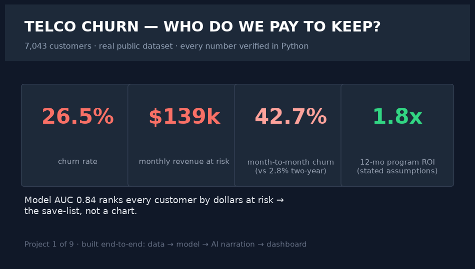
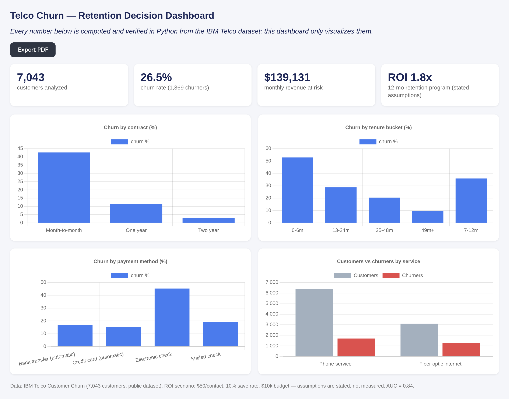
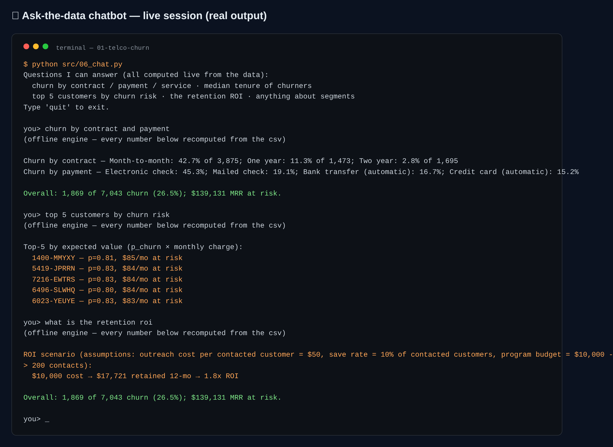

# Telco Churn — Retention Decision (Consulting)





*The interactive dashboard — single-file HTML, opens by double-click, PDF-export button included.*



*The ask-the-data chatbot (`src/06_chat.py`) — answers computed live from the data; a real session.*

**Dataset:** IBM Telco Customer Churn — 7,043 customers, real public dataset
(live source: `https://raw.githubusercontent.com/IBM/telco-customer-churn-on-icp4d/master/data/Telco-Customer-Churn.csv`).

## The decision
> Which customers should we spend retention money on, and what's the program's ROI?

## What I did
1. **Cleaned and verified** the raw data (11 blank TotalCharges = new customers with tenure 0 → numeric).
2. **Computed churn facts** — every number below is recomputed from `data/processed/telco_clean.csv`, then narrated.
3. **Modeled prior churn risk** with an interpretable logistic regression (one-hot features, stratified 80/20 split, ROC AUC **0.84** on held-out test set).
4. **Ranked every customer** by expected_value = p_churn × monthly charge → ranked save list (`outputs/risk_scores.csv`).
5. **Priced the retention program** and narrated the decision with the AI narration layer.

## Headline numbers (verified)
- **26.5%** churn — 1,869 of 7,043 customers
- **~$139.1k** monthly revenue at risk (MRR of churners); ~$2.86M lifetime value gone
- **Month-to-month contract churn 42.7%** vs ~2.8% on two-year contracts — the smoking gun
- Churners are brand-new: median tenure **10 months** vs 38 for stayers (acquisition-quality problem)
- Model: AUC 0.84

## The priced program (stated assumptions, not facts)
Contact the top-expectation-value customers: outreach cost **$50/customer**, **10%** save rate, budget **$10,000** → 200 contacts retains ~**$1,477/month** MRR, **$17.7k** retained over 12 months → **~1.77× 12-month ROI**. Change any assumption and rerun `02` to re-price.

## How to run
```bash
python3 -m venv .venv
.venv/bin/pip install -r requirements.txt
.venv/bin/python src/00_download_data.py   # downloads the public dataset
.venv/bin/python src/01_prepare_analysis.py
.venv/bin/python src/02_model_roi.py
.venv/bin/python src/03_ai_insights.py     # add an LLM key in .env for real narration
.venv/bin/python src/04_dashboard.py       # outputs dashboard/index.html — open it
```

## Chatbot (ask the data)
```bash
.venv/bin/python src/06_chat.py          # interactive REPL
.venv/bin/python src/06_chat.py "churn by contract"   # one-shot
```
Answers contract/payment/internet churn, median tenure, top-5 save-list, and the ROI scenario — **every number computed live from the CSV**; with `GROQ_API_KEY` the LLM narrates verified facts only (offline engine otherwise).

## The AI rule
> **Python computes and verifies every number. AI explains, prioritizes and frames — it never invents a metric.**

With `GROQ_API_KEY` (or Gemini/OpenAI) in `.env`, 03 sends ONLY verified numbers to the LLM; without an internet connection/token it falls back to a deterministic offline narrative engine. Nothing breaks either way.

## Limitations (honest)
- Public dataset → findings are **directional** on a real churn problem at one US telecom snapshot (2018); no seasonality, no causal identification.
- ROI scenario costs are **written-down assumptions**, not measured — rerun with your own numbers.
- Log-loss/calibration not tuned — segmentation and lift matter more here.
- Individual features like TotalCharges are future-based in the raw form; scoring uses only the attached snapshot features.

## Files
- `data/` raw + clean CSVs · `outputs/` kpis.json, model_eval.json, risk_scores.csv, seg_*.csv, insights.md, charts, linkedin_hero.png
- `assets/` dashboard.png, chatbot.png, hero + chart renders (for this README & LinkedIn)
- `sql/analysis.sql` SQLite/BigQuery SQL reproducing the headline metrics
- `dashboard/index.html` self-contained interactive PDF-exportable dashboard
- `src/` the pipeline (00 download → 01 analysis → 02 model → 03 AI → 04 dashboard → 05 hero → 06 chat → 07 screenshots) · `requirements.txt` · `.env.example`
