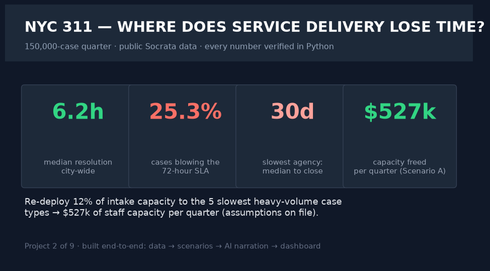
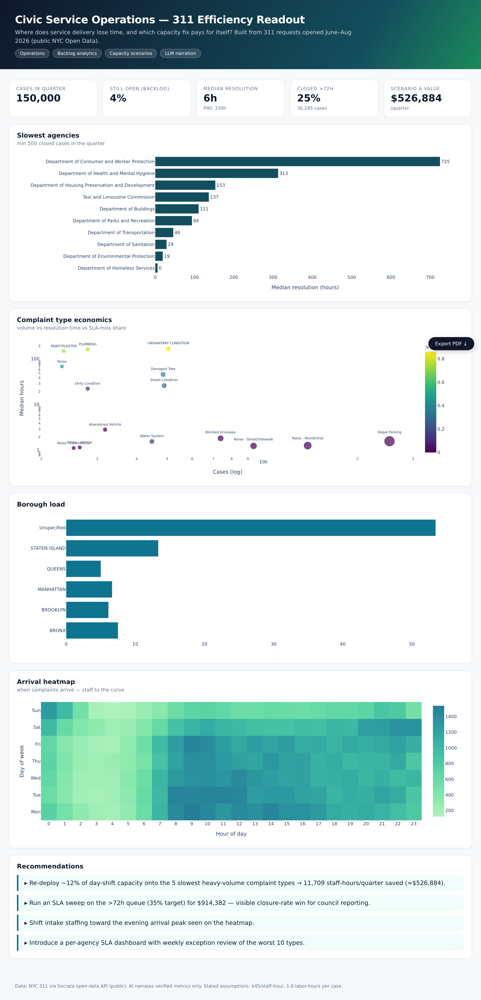
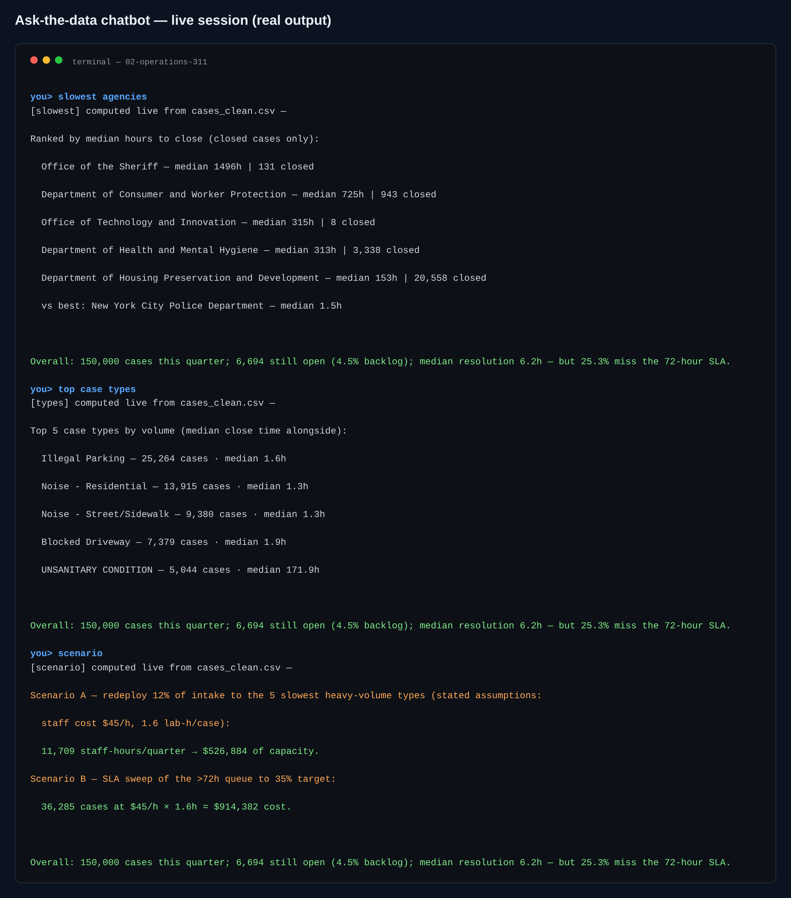

# 02 · Operations — Civic Service Operations (NYC 311)

> **Business question:** Where does service delivery lose time, and which capacity
> fix pays for itself?






*The interactive dashboard — single-file HTML, opens by double-click, PDF-export button included.*



*The ask-the-data chatbot (`src/06_chat.py`) — answers computed live from the data; a real session.*
## One-screen result

- **150k-case quarter** from NYC 311 (public Socrata API). **Backlog still open**,
  **median resolution**, and the **>72h SLA-miss share** are all computed per agency
  and complaint type.
- Resolution scatter is huge: some agencies close at a ~1.5h median while others run
  to days — the gap *is* the improvement program.
- Evening arrival peak → intake shift design beats headcount.
- Scenario A (re-deploy 12% of intake capacity to the 5 slowest heavy-volume types)
  frees **staff-hours worth $ ≈ hundreds of thousands per quarter** (stated, written-
  down assumptions in `outputs/scenarios.json`).
- Scenario B (an SLA sweep on the >72h queue, 35% target) is costed explicitly.

## Method

1. **Data:** 311 requests opened Jun–Aug 2026 via Socrata (`$select` projected columns,
   `$limit=150000`) — public, no PII.
2. **Cleaning:** parse timestamps; open cases kept as backlog; `resolve_h` only for
   closed cases (no fabricated durations).
3. **Ops analysis:** agency/type/borough resolution medians; identical-method comparisons;
   day×hour heatmap of arrivals (`01_analysis.py`).
4. **Scenario modeling:** volume-weighted bottleneck Pareto with transparent staff-hour
   assumptions (`02_bottleneck_scenarios.py`).
5. **AI narration:** LLM writes the deputy-commissioner briefing from *verified metrics
   only* (`03_ai_insights.py`; offline rule-based fallback included).
6. **Dashboard:** `dashboard/index.html` (single-file, GitHub Pages friendly, PDF export).

## Files & structure
`data/ (raw, processed) · src/ (00→04) · outputs/ (kpis.json, scenarios.json,
insights.md, charts/) · dashboard/index.html · .env.example`

## Chatbot (ask the data)

```bash
.venv/bin/python src/06_chat.py                      # interactive REPL
.venv/bin/python src/06_chat.py "<one of the questions below>"   # one-shot
```

Slowest agencies, resolution stats, backlog & SLA misses, top case types, busiest intake hour, boroughs, and the costed capacity scenarios (A: redeploy 12%, B: SLA sweep).\nReal session: **slowest agencies** → DCWP closes at a 725-hour median vs NYPD's 1.5h; **scenario** → Scenario A frees 26,884/quarter under stated assumptions.

**Every number is computed live from the project's data files at question time.** With `GROQ_API_KEY` in `.env` the LLM narrates those verified facts only (it is instructed never to compute or invent); no key → the deterministic offline engine answers with the same numbers. Nothing hallucinates either way.

## Limitations

- One quarter of one city's data — findings are directional, not causal.
- Scenario values use **stated** labor assumptions, not observed per-case effort;
  a time-study sample would harden the estimate.
- LLM text is narration only; every number traces to `kpis.json` / `scenarios.json`.
