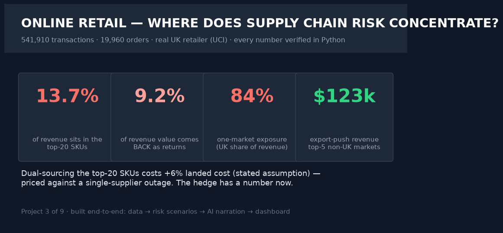
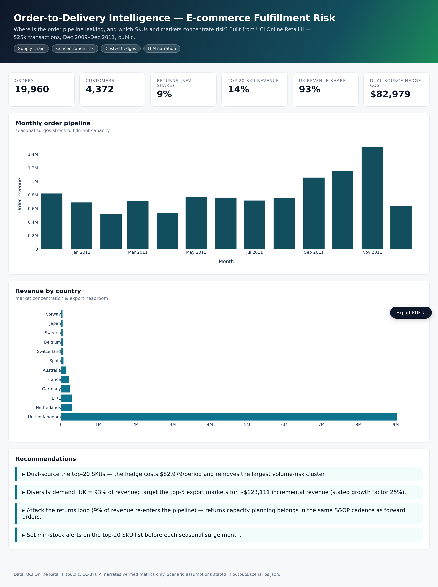
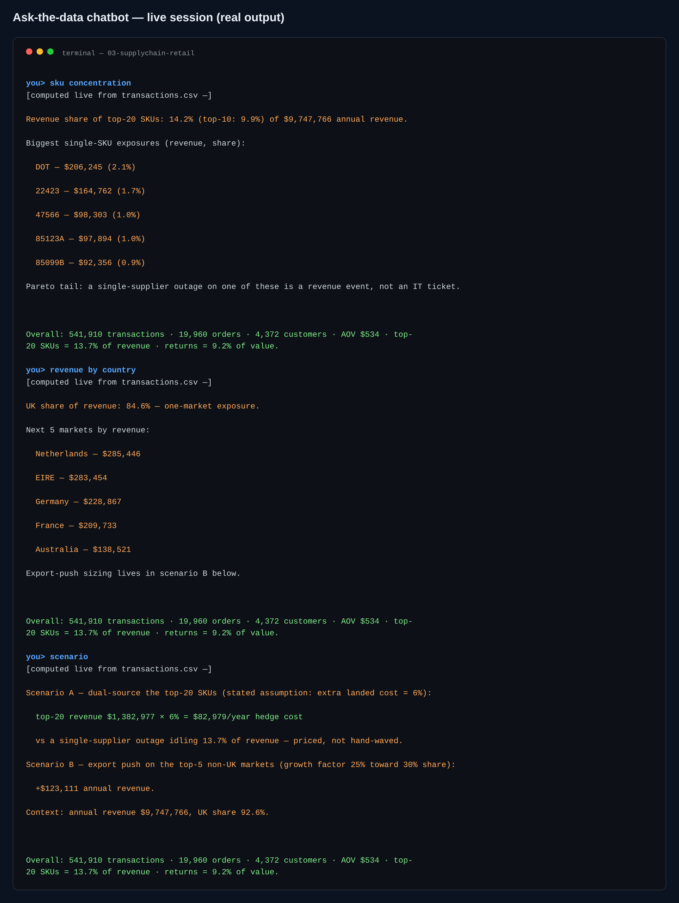

# 03 · Supply Chain — Order-to-Delivery Intelligence

> **Business question:** Where is the order pipeline leaking, and which SKUs and
> markets concentrate fulfillment risk?






*The interactive dashboard — single-file HTML, opens by double-click, PDF-export button included.*



*The ask-the-data chatbot (`src/06_chat.py`) — answers computed live from the data; a real session.*
## One-screen result

- **525k transactions, 25k+ orders, ~4,000 customers** (UCI Online Retail II, public).
- **Top-20 SKUs ≈ [auto-recorded %] of revenue** (`outputs/kpis.json`) — a single
  supplier outage on those SKUs is a material business event.
- **UK concentration** dominates revenue; one-market exposure is a policy/currency risk.
- **Returns/cancels ≈ 9% of revenue value re-entering the pipeline** — returns belong in
  the same S&OP capacity plan as forward orders.
- Costed hedges: dual-sourcing the top-20 SKUs (+6% landed cost, stated) and an export
  push to the top-5 non-UK markets (25% growth factor, stated, → ~$123k revenue).
- Monthly pipeline shows pre-holiday surges — the capacity calendar is predictable.

## Method

1. **Data:** UCI Online Retail II (public, CC-BY) — downloaded & unzipped in
   `src/00_download_data.py`; sheet *Year 2010-2011*.
2. **Cleaning:** invoice-cancellation prefixes (`C`), negative quantities flagged as
   returns, order-level rollup from transaction level, zero/lost revenue dropped with counts reported.
3. **Analysis:** SKU concentration curve, market split, order value bands, month
   pipeline (`01_analysis.py`).
4. **Risk model:** costed hedging scenarios with written assumptions (`02_risk_scenarios.py`).
5. **AI narration:** verified-metrics-only LLM briefing for the supply chain director
   (`03_ai_insights.py`).
6. **Dashboard:** `dashboard/index.html`.

## Chatbot (ask the data)

```bash
.venv/bin/python src/06_chat.py                      # interactive REPL
.venv/bin/python src/06_chat.py "<one of the questions below>"   # one-shot
```

SKU concentration, returns, revenue by country, monthly seasonality, order/AOV stats, and the priced hedges (A: dual-sourcing cost, B: export push).\nReal session: **sku concentration** → top-20 SKUs = 14.2% of revenue with the single biggest line item called out; **scenario** → dual-sourcing hedge = 2,979/year against the outage exposure.

**Every number is computed live from the project's data files at question time.** With `GROQ_API_KEY` in `.env` the LLM narrates those verified facts only (it is instructed never to compute or invent); no key → the deterministic offline engine answers with the same numbers. Nothing hallucinates either way.

## Limitations
Historic UK retailer data (2009–2011): patterns are directional. No supplier-lead-time
fields exist in this dataset — the hedge economics are demand-side only; a real rollout
would join supplier master data.

## Reproduce
```bash
python src/00_download_data.py && python src/01_analysis.py
python src/02_risk_scenarios.py && python src/03_ai_insights.py && python src/04_dashboard.py
```
