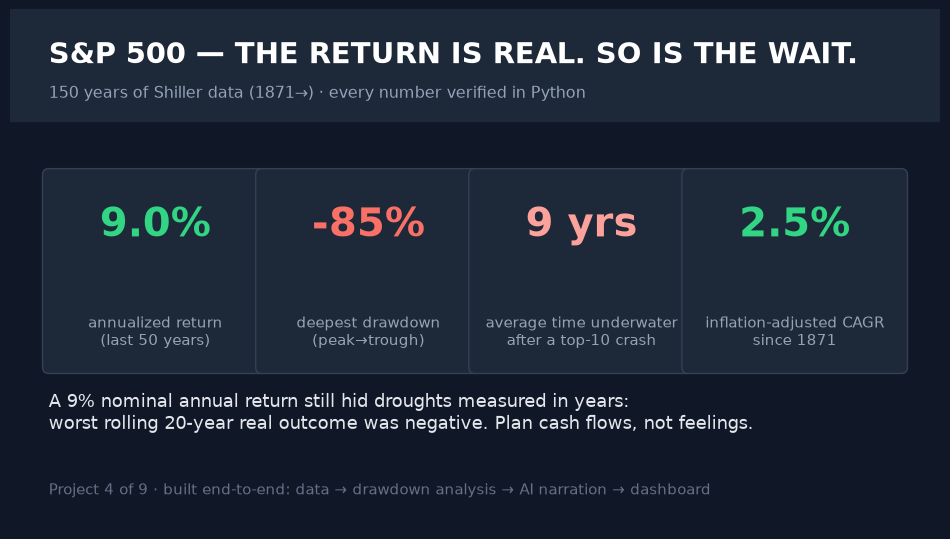
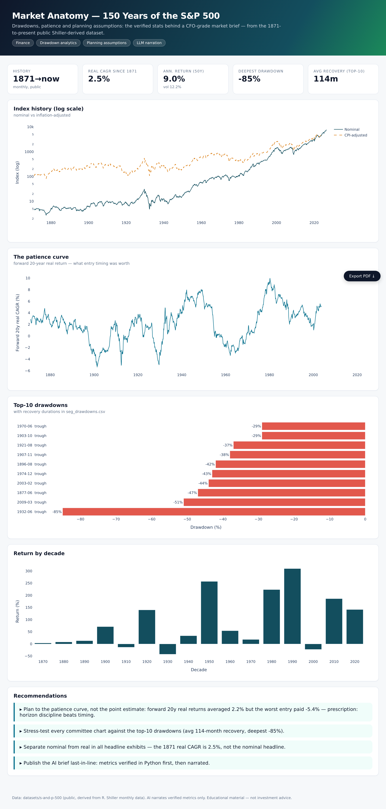

# 04 · Finance — Market Anatomy: 150 Years of the S&P 500

> **Business question:** What do drawdown history and the "patience curve" actually
> imply for planning assumptions — and can AI write the brief the CFO needs?






*The interactive dashboard — single-file HTML, opens by double-click, PDF-export button included.*


*The ask-the-data chatbot (`src/06_chat.py`) — answers computed live from the data; a real session.*
## One-screen result

- **1,869 months, 1871→present** (public Shiller-derived dataset).
- **Real (CPI-adjusted) CAGR since 1871:** computed in `kpis.json` — the honest number
  behind the nominal headline.
- **Top-10 drawdowns:** deepest ≈ **-85%** (1929-era peak-to-trough), top-10 average
  recovery ≈ **114 months** — planning must internalize decade-scale recoveries.
- **Forward 20-year real CAGR:** from **-5.4%** (worst entry) to +6%+ (p90); the median
  entry pays more than the worst by double digits — horizon discipline > timing.
- Annual extremes recorded (best/worst year) to size committee stress tests.

## Method

1. **Data:** `datasets/s-and-p-500` GitHub CSV (public; derived from R. Shiller's monthly
   data). Columns: index, CPI, GS10, PE10, real series.
2. **Cleaning:** recent rows fill CPI with 0 → treated as missing (documented); all math
   in `01_analysis.py` with explicit numeric coercion.
3. **Drawdown engine:** peak-trough-recovery episode detection over the full series
   (not merely monthly changes) — top-10 table with durations.
4. **Patience curve:** forward 20y real CAGR aligned at every entry month (CPI begins 1913).
5. **AI:** LLM writes the CFO brief from verified stats only (`02_ai_market_brief.py`);
   offline fallback engine runs without any key.
6. **Dashboard:** `dashboard/index.html` (log-scale history, drawdown leaderboard,
   decade returns, patience curve).

## Chatbot (ask the data)

```bash
.venv/bin/python src/06_chat.py                      # interactive REPL
.venv/bin/python src/06_chat.py "<one of the questions below>"   # one-shot
```

Deepest drawdowns, recovery times, real vs nominal returns, decade returns, best/worst years, Shiller PE10.\nReal session: **drawdowns** → 1929 peak took 24.9 years to recover; **recovery times** → average top-10 crash = 9.5 years underwater.

**Every number is computed live from the project's data files at question time.** With `GROQ_API_KEY` in `.env` the LLM narrates those verified facts only (it is instructed never to compute or invent); no key → the deterministic offline engine answers with the same numbers. Nothing hallucinates either way.

## Limitations
Monthly data understates intramonth drawdowns; the index is not a tradable portfolio
(no taxes/costs). Educational material — not investment advice.
