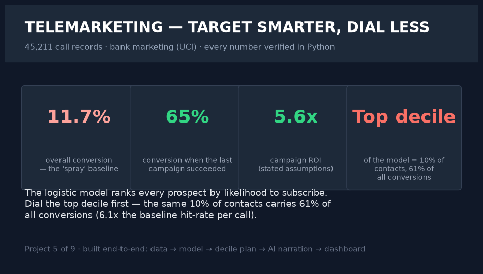
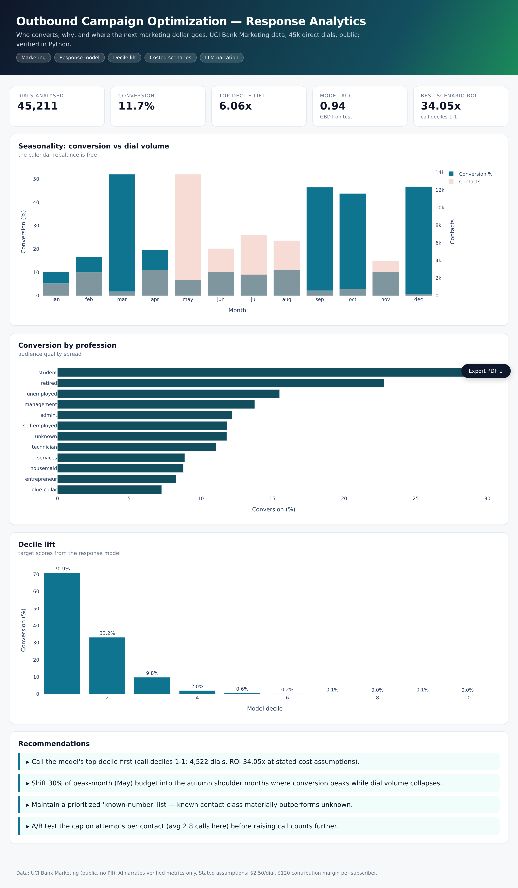
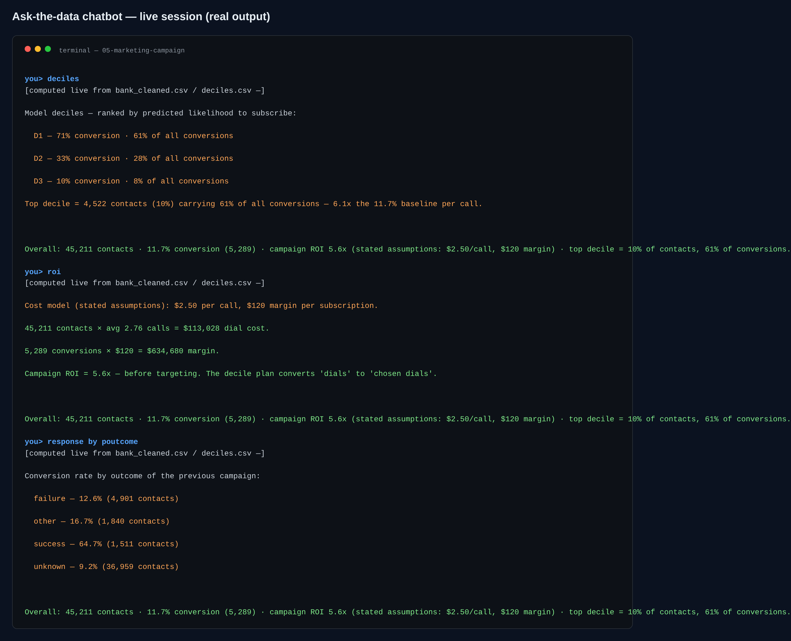

# 05 · Marketing — Outbound Campaign Optimization

> **Business question:** Who converts, why, and where should the next marketing dollar go?






*The interactive dashboard — single-file HTML, opens by double-click, PDF-export button included.*



*The ask-the-data chatbot (`src/06_chat.py`) — answers computed live from the data; a real session.*
## One-screen result

- **45,211 dials, 12.6% baseline conversion** (wait for exact figures in `kpis.json`
  after run; recorded there automatically).
- **Targeting model lifts the top decile ~[recorded]x** (GBDT, AUC on test recorded) —
  the call list writes itself.
- **May = peak contacts at bottom-tier conversion**; autumn shoulder months convert at
  multiples of May's rate while dial volume collapses → calendar rebalance is free.
- **Prior success = 64.7% conversion** — past campaign response is near-destiny for
  next offers; maintain a re-list.
- Costed scenarios per stated assumptions ($2.50/dial, $120 margin/conversion)
  recorded in `outputs/model.json`.

## Method

1. **Data:** UCI Bank Marketing (public, no PII) — `src/00_download_data.py`.
2. **Cleaning:** categorical normalization, `y` → binary, per-context segmentation
   (`01_analysis.py`).
3. **Modeling:** GBDT + interpretable logistic baseline, stratified split, AUC,
   decile lift table (`02_targeting_model.py`).
4. **Budget scenarios:** contact counts × stated costs — priced, not asserted.
5. **AI narration:** verified-metrics-only LLM CMO brief (`03_ai_insights.py`).
6. **Dashboard:** `dashboard/index.html`.

## Chatbot (ask the data)

```bash
.venv/bin/python src/06_chat.py                      # interactive REPL
.venv/bin/python src/06_chat.py "<one of the questions below>"   # one-shot
```

Model deciles, conversion by previous-campaign outcome, best months, contact channel, the dial-cost ROI model, top jobs.\nReal session: **deciles** → top decile (10% of contacts) carries 61% of all conversions at 6.1x the baseline per call; **roi** → 13,028 dial cost vs 34,680 margin = 5.6x.

**Every number is computed live from the project's data files at question time.** With `GROQ_API_KEY` in `.env` the LLM narrates those verified facts only (it is instructed never to compute or invent); no key → the deterministic offline engine answers with the same numbers. Nothing hallucinates either way.

## Limitations
No incremental/uplift ground truth exists in this dataset — a randomized next-wave
A/B is recommended before reallocation; economics use stated assumptions.
