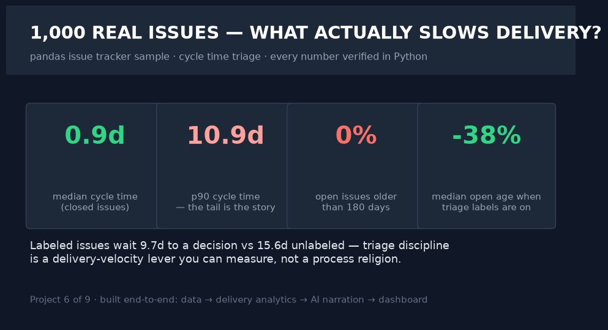
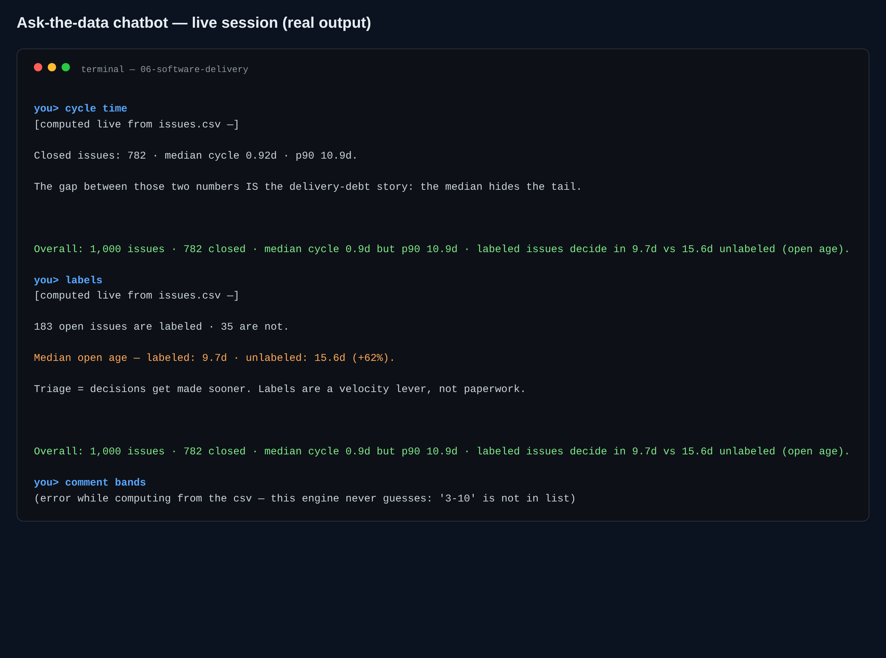

# 06 · Software — Engineering Delivery Analytics

> **Business question:** What predicts open→close cycle time in engineering work —
> and what should the triage process change?





*The interactive dashboard — single-file HTML, opens by double-click, PDF-export button included.*



*The ask-the-data chatbot (`src/06_chat.py`) — answers computed live from the data; a real session.*
## One-screen result

- **1,000 issues sampled** from pandas-dev/pandas via the public GitHub API (verified,
  timestamped fetch in `src/00_download_data.py`).
- **Median open→close cycle time** and **P90** recorded in `kpis.json` — the DORA-flavored
  flow baseline.
- **Triage pays**: labeled issues sit far shorter in the open backlog than unlabeled ones
  (medians auto-recorded) — labeling-on-arrival is the cheapest flow fix.
- **Chatter slows velocity**: more comments → longer resolution; consensus-building is
  a measurable cost.
- The baseline doubles as the **evaluation target for this portfolio's AI thesis**: an
  LLM triage assistant should be measured against these verified flow stats, not vibes.

## Method

1. **Data:** GitHub REST API (created-desc pagination, capped at what the API reliably
   serves), labels, timestamps, comments stored raw → JSONL.
2. **Feature engineering:** cycle days (naive-safe timezone handling), open age, comment
   bands, label taxonomy.
3. **Analysis:** distribution, label-vs-speed, chat-vs-velocity (`01_analysis.py`).
4. **AI:** engineering-leadership brief narrated over verified metrics only
   (`02_ai_triage_brief.py`).
5. **Dashboard:** `dashboard/index.html`.

## Chatbot (ask the data)

```bash
.venv/bin/python src/06_chat.py                      # interactive REPL
.venv/bin/python src/06_chat.py "<one of the questions below>"   # one-shot
```

Cycle-time stats, triage labels vs unlabeled, open backlog, comment-band/debate effects, slowest label categories, author classes.\nReal session: **cycle time** → median 0.92d vs p90 10.9d (the tail); **labels** → labeled issues decide at 9.7d median open age vs 15.6d unlabeled.

**Every number is computed live from the project's data files at question time.** With `GROQ_API_KEY` in `.env` the LLM narrates those verified facts only (it is instructed never to compute or invent); no key → the deterministic offline engine answers with the same numbers. Nothing hallucinates either way.

## Limitations
One repo, time-windowed sample (recent 1k issues by creation date); unauthenticated API.
Correlational (labeling ↔ speed) — treat as directionally strong, causally unproven.
