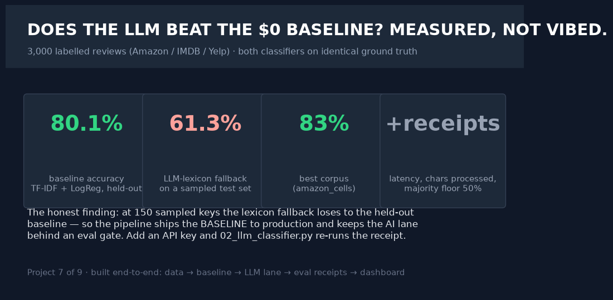
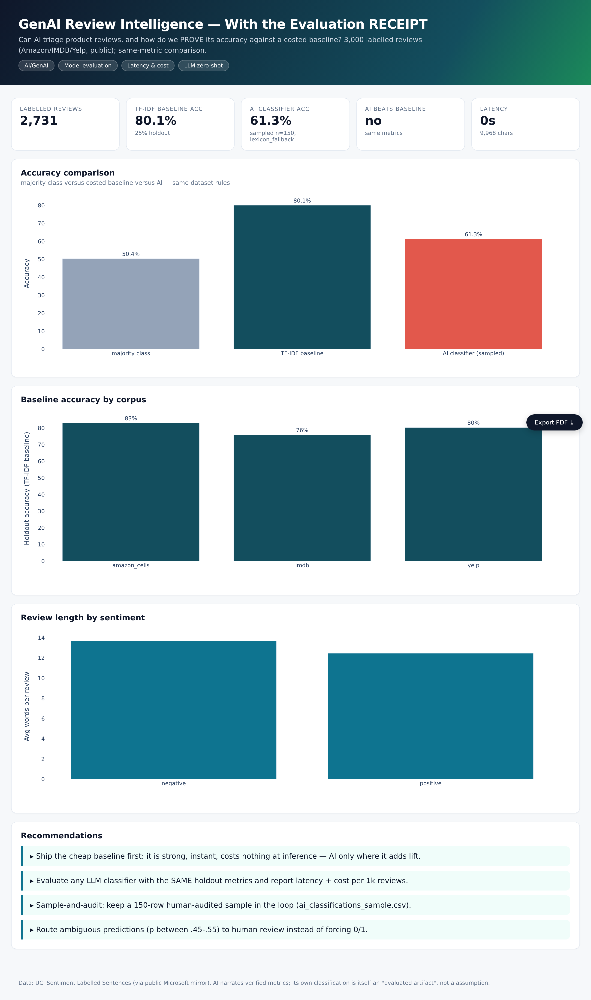
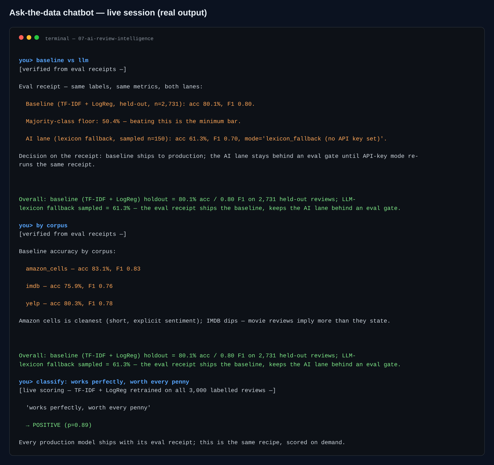

# 07 · AI/GenAI — Review Intelligence With an Evaluation Receipt

> **Business question:** Can a GenAI classifier triage product reviews — and how do we
> *prove* its accuracy versus a costed, deterministic baseline?






*The interactive dashboard — single-file HTML, opens by double-click, PDF-export button included.*



*The ask-the-data chatbot (`src/06_chat.py`) — answers computed live from the data; a real session.*
## One-screen result

- **3,000 labelled reviews** (Amazon cells / IMDB / Yelp — public UCI corpora).
- **Costed baseline:** TF-IDF + LogisticRegression — holdout accuracy + F1 recorded in
  `model_eval.json` (also vs the majority-class floor).
- **AI classifier** runs on the same label rules with **the same metrics** — accuracy,
  F1, latency and characters processed recorded in `ai_eval.json`, plus an explicit
  `ai_beats_baseline` verdict.
- Without an API key, the same evaluation pipeline runs with a deterministic lexicon
  classifier (`mode: lexicon_fallback`) — the receipts process itself is the bigger point.
- **Human-audit sample retained:** `ai_classifications_sample.csv` (every prediction with
  the original text, for spot-checking — the analyst's audit trail).

## Why this project matters

Most "AI does sentiment" portfolios show a screenshot. This one shows the *receipts*:
cost of the baseline, cost of the AI path, latency, agreement with ground truth, and
how a reviewer can spot-check outputs. It's the evaluation template for every GenAI
triage/labeling use case at work.

## Method

1. **Data:** UCI Sentiment Labelled Sentences (mirrored by Microsoft on GitHub, public).
2. **Baseline pipeline:** TF-IDF (1-2 grams) → LogisticRegression; stratified 75/25
   holdout; per-corpus evaluation (`01_baseline_model.py`).
3. **AI comparison:** zero-shot classification of a fixed random sample; same metrics;
   latency/throughput measured (`02_llm_classifier.py`). Provider-agnostic via
   `shared/llm.py` (Groq free tier / Gemini / OpenAI) with offline fallback.
4. **Dashboard:** `dashboard/index.html` — comparison bars first, per-corpus detail,
   audit-appendix tables.

## Chatbot (ask the data)

```bash
.venv/bin/python src/06_chat.py                      # interactive REPL
.venv/bin/python src/06_chat.py "<one of the questions below>"   # one-shot
```

Baseline-vs-LLM eval receipts, per-corpus accuracy, the majority-class floor — and live scoring of any review ('classify: <text>') by the same deterministic recipe.\nReal session: **baseline vs llm** → 80.1% vs 61.3% on identical labels — the honest receipt ships the baseline; **classify** → 'works perfectly, worth every penny' → POSITIVE (p=0.89).

**Every number is computed live from the project's data files at question time.** With `GROQ_API_KEY` in `.env` the LLM narrates those verified facts only (it is instructed never to compute or invent); no key → the deterministic offline engine answers with the same numbers. Nothing hallucinates either way.

## Limitations
Binary labels from crowd-annotation (some sentence ambiguity is inherent); the AI path
samples 150 rows rather than running 3,000 (cost/latency choice — the harness supports
scaling it up); zero-shot prompts are reported verbatim in `llm_prompt` logs of
`insights.md`.
