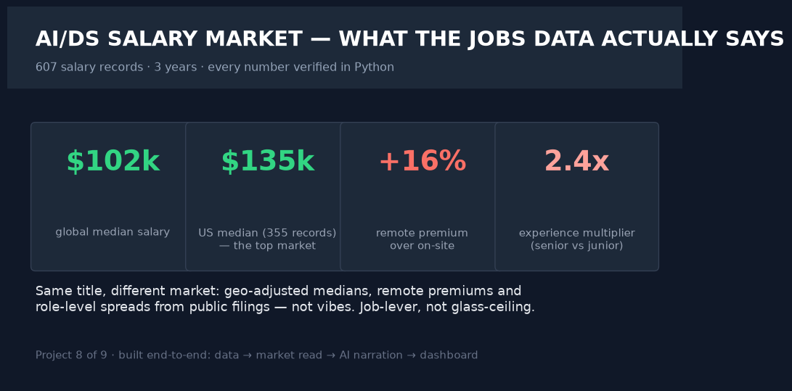
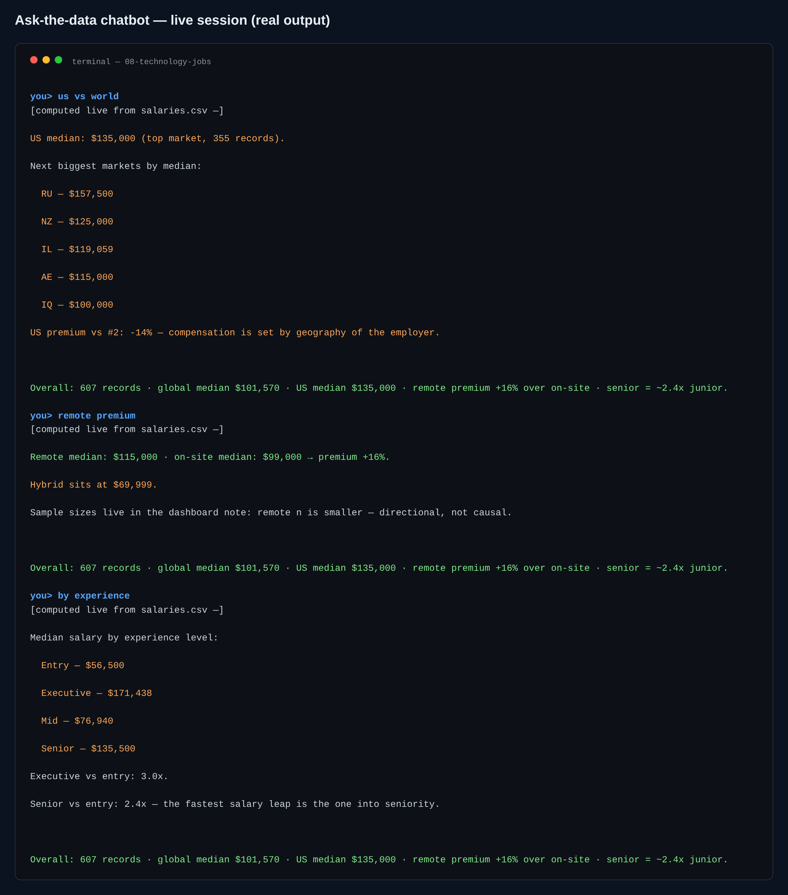

# 08 · Technology — AI/Data Job Market Intelligence

> **Business question:** Which roles and geographies are over- or under-paid, and how
> should candidates & hiring managers price themselves?





*The interactive dashboard — single-file HTML, opens by double-click, PDF-export button included.*



*The ask-the-data chatbot (`src/06_chat.py`) — answers computed live from the data; a real session.*
## One-screen result

- **~600 records spanning multiple years** of AI/data salaries (public mirror of the
  Kaggle ds_salaries dataset), all figures verified in Python.
- **Leveling > titles:** senior (SE) medians run ~2.4× entry (EN) — the biggest single
  lever is leveling, not naming.
- **Geography ladder:** leader market at the top of the ladder (`top_market` in
  `kpis.json`); remote medians vs onsite medians recorded side-by-side.
- **Role spread ~2.4×** between lowest- and highest-median roles (n≥10 filter, honest).
- Year-over-year median trajectory captured in `seg_year.csv`.

## Method

1. **Data:** public GitHub mirror (`src/00_download_data.py`), 12 columns incl. USD-normalized pay.
2. **Cleaning:** remote_ratio → onsite/hybrid/remote labels; USD unify; records filters
   stated (n≥30 for geographies, n≥10 for roles).
3. **Analytics:** medians by geography, role, experience, year; box + scatter panels
   (`01_analysis.py`).
4. **AI narration:** career-strategy note over verified metrics only, with honest
   sample caveats (`02_ai_market_note.py`).
5. **Dashboard:** `dashboard/index.html`.

## Chatbot (ask the data)

```bash
.venv/bin/python src/06_chat.py                      # interactive REPL
.venv/bin/python src/06_chat.py "<one of the questions below>"   # one-shot
```

US-vs-world medians, remote premium, top roles, experience multipliers, year trend, company size.\nReal session: **remote premium** → 15,000 vs 9,000 = +16%; **by experience** → entry 6.5k → senior 35.5k (2.4x) → executive 71.4k.

**Every number is computed live from the project's data files at question time.** With `GROQ_API_KEY` in `.env` the LLM narrates those verified facts only (it is instructed never to compute or invent); no key → the deterministic offline engine answers with the same numbers. Nothing hallucinates either way.

## Limitations
~600 records skew toward certain markets and years (documented in the AI note); medians
≠ offers; saga of remote-work normalization since 2020 makes year-level claims fragile.
