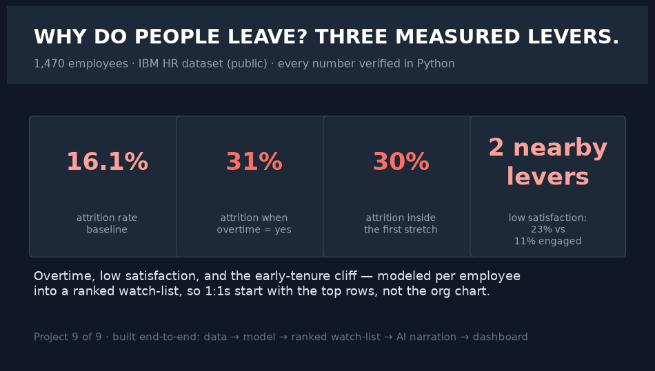
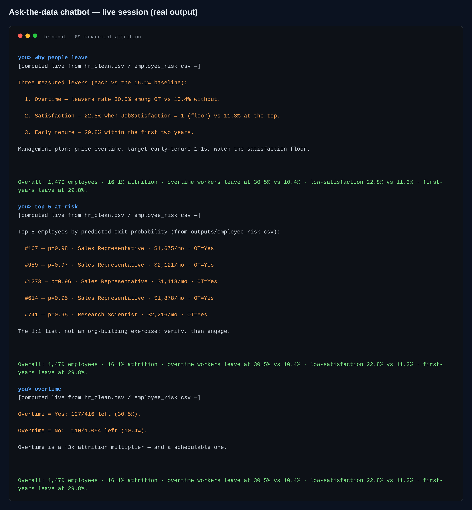

# 09 · Management — Workforce Attrition & Retention

> **Business question:** Who is at risk, where does attrition concentrate, and which
> retention lever pays for itself?





*The interactive dashboard — single-file HTML, opens by double-click, PDF-export button included.*



*The ask-the-data chatbot (`src/06_chat.py`) — answers computed live from the data; a real session.*
## One-screen result

- **1,470 employees** (public IBM HR Analytics dataset; no real PII).
- **Overtime = the sharpest flag:** attrition ~2.6× higher among overtime staff — and they
  **earn MORE** on average (the `income_gap` KPI), so money isn't the lever; workload is.
- **New hires ≤2y exit at ~30%** vs ~11% for 7y+ staff — the first 730 days own the risk.
- **Model:** GBDT + interpretable logistic readout (AUC recorded); ≥50%-risk cohort sized.
- **Retention ROI (stated, conservative):** $45k replacement cost, $3k package, 25% save
  rate → positive net uplift, assumptions written down in `model.json`.

## Method

1. **Data:** public mirror (`00_download_data.py`).
2. **People analytics:** attrition by overtime, satisfaction, tenure, role, income band
   (`01_analysis.py`).
3. **Model:** interpretable drivers + GBDT importance, stratified split (`02_model_retention.py`).
4. **AI narration:** HR-director brief over verified metrics, **including an ethics note**
   on individualized scoring (`03_ai_insights.py`).
5. **Dashboard:** `dashboard/index.html` — concentration bars, role/tenure/income panels,
   costed ROI card.

## Chatbot (ask the data)

```bash
.venv/bin/python src/06_chat.py                      # interactive REPL
.venv/bin/python src/06_chat.py "<one of the questions below>"   # one-shot
```

The three measured levers, overtime, satisfaction floor, tenure buckets, departments, income gap, and the top-5 ranked at-risk list from the model.\nReal session: **why people leave** → overtime 30.5% vs 10.4%, early tenure 29.8%, satisfaction floor vs top quantified; **top 5 at-risk** → the ranked 1:1 watch-list from employee_risk.csv.

**Every number is computed live from the project's data files at question time.** With `GROQ_API_KEY` in `.env` the LLM narrates those verified facts only (it is instructed never to compute or invent); no key → the deterministic offline engine answers with the same numbers. Nothing hallucinates either way.

## Limitations
Snapshot data (no exit interviews or leaver dates); stated cost assumptions need
calibration to a real org; ethics guardrail: aggregate-only dashboards until a
governance review — no protected attributes in the model.
